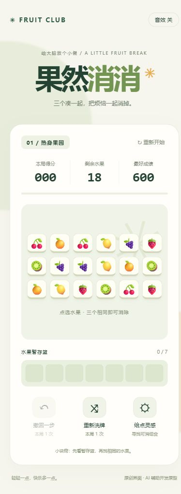

# 果然消消 | AI 辅助开发作品

轻量的水果卡片三消网页小游戏。使用 AI 辅助完成界面设计、代码生成和调试，并通过浏览器检查实际交互。

## 如何体验

下载并解压“果然消消-AI应用能力作品.zip”，双击其中的“打开游戏.html”，即可在浏览器中离线游玩。无需安装依赖。

## 玩法与功能

点击水果放入七格暂存篮，三个相同图案自动消除。清空果园获胜，篮子满七格失败。

- 热身果园：18张卡片。
- 双层果园：54张卡片，上层取走后露出下层。
- 每局一次撤回、一次洗牌，组合提示、开关音效、本地最高分。
- 手机竖屏布局与桌面浏览器适配。

## AI 的使用

将“做一个可截图展示的轻量三消小游戏”拆分为规则、界面和交互需求，使用 Codex 生成 HTML、CSS 和 JavaScript，再根据浏览器实测修复失败弹窗按钮显示与手机卡片挤出的问题。游戏运行本身不调用 AI 接口。

## 技术实现与验证

原生 HTML / CSS / JavaScript，无后端、无外部依赖。使用浏览器 localStorage 保存最高分；浏览器不允许保存时仍可游玩。

已通过浏览器实测热身关通关、七格满篮失败、撤回、洗牌、组合提示，并检查390像素宽度的手机布局。

## 文件说明

- 果然消消-双击即玩.html：集成样式和脚本的离线单文件版。
- index.html、style.css、game.js：分离的 HTML、CSS、JavaScript。
- 两张 JPG：实际游戏界面截图。

## 当前范围

这是 AI 辅助开发的浏览器原型，未接入抖音小游戏 SDK、未上架。随机牌局未实现必有解生成。没有广告、付费或账号系统。

## 界面预览

